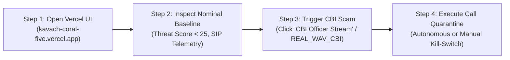
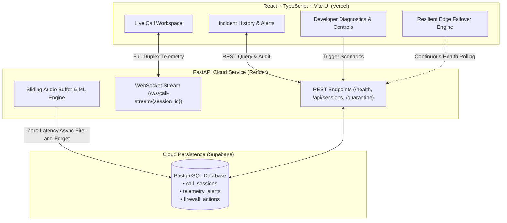
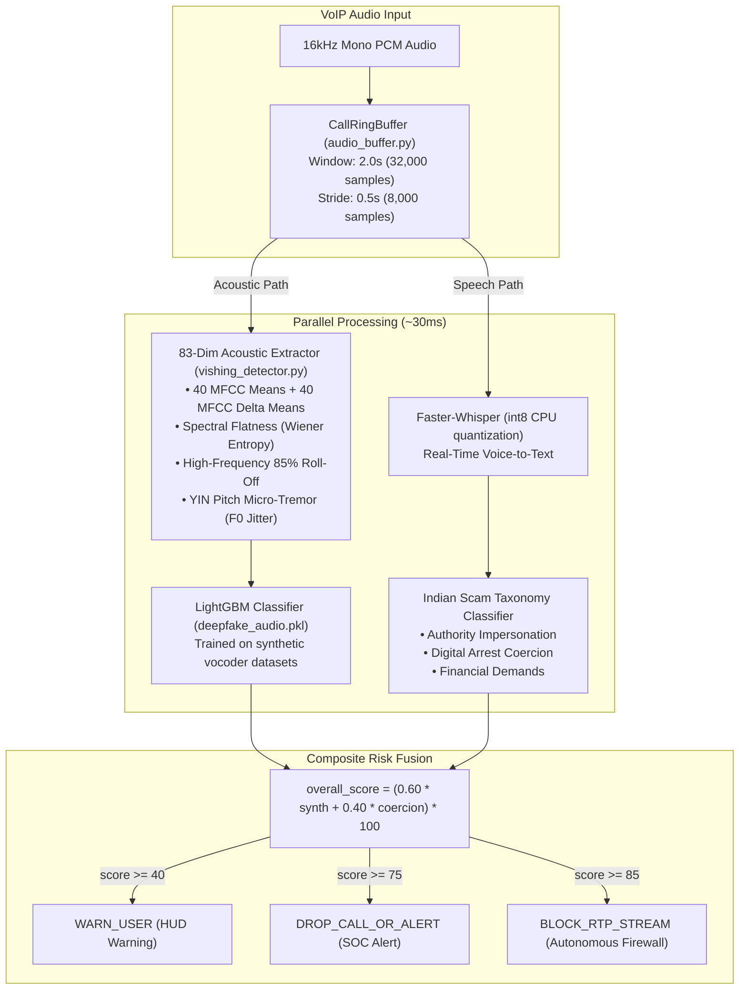

# Kavach-VoIP 🛡️
### Real-Time Deepfake Voice & Vishing Network Call Firewall
**Built for SVIT HackFest 2026 by Team Runtime Terrors**

[](https://kavach-coral-five.vercel.app)
[](https://fastapi.tiangolo.com)
[](https://react.dev)
[](https://vitejs.dev)
[](https://python.org)
[](https://lightgbm.readthedocs.io)
[](https://github.com/SYSTRAN/faster-whisper)
[](https://librosa.org)
[](https://supabase.com)
[](https://render.com)
[](LICENSE)

---

## 🌐 Live Production Links

| Service | Environment | URL |
| :--- | :--- | :--- |
| **Live Cyber-SOC Frontend** | Vercel Edge Global CDN | [https://kavach-coral-five.vercel.app](https://kavach-coral-five.vercel.app) |
| **Live Backend API** | Render Cloud Container | [https://kavach-n5na.onrender.com](https://kavach-n5na.onrender.com) |
| **Interactive Swagger API Docs** | OpenAPI 3.1 / ReDoc | [https://kavach-n5na.onrender.com/docs](https://kavach-n5na.onrender.com/docs) |
| **Live Health & ML Status** | Real-time Engine Diagnostic | [https://kavach-n5na.onrender.com/health](https://kavach-n5na.onrender.com/health) |
| **WebSocket Stream Endpoint** | Full-Duplex Bi-Directional | `wss://kavach-n5na.onrender.com/ws/call-stream/{session_id}` |

---

## ⚡ How to Test Live (Step-by-Step Judge Walkthrough)

Experience the complete end-to-end defense system live in under 60 seconds:



1. **Open the Live Cyber-SOC Dashboard**:
   - Navigate to [https://kavach-coral-five.vercel.app](https://kavach-coral-five.vercel.app) in any modern browser.
   - The UI automatically verifies connectivity against `https://kavach-n5na.onrender.com/health`. If the cloud container is waking up from idle, the UI seamlessly engages edge telemetry mode with zero downtime.

2. **Inspect the Nominal Call Baseline**:
   - The **Call Workspace** displays an active call session with benign biometric parameters:
     - **Threat Score**: `< 25` (**Nominal Risk**, Green HUD).
     - **VoIP Telemetry**: Protocol `SIP/2.0 over WSS`, Codec `Opus 48kHz Stereo`, Jitter `1.8 ms`, Packet Loss `0.0%`.
     - **Acoustic Biomarkers**: `Synthetic Voice: 4% Prob`, `Carrier Reputation: High Trust`, `Acoustic Stress: 14% Baseline`.

3. **Inject the CBI Digital Arrest Deepfake Audio Stream**:
   - In the **Backend Demo Scenario Triggers** toolbar at the bottom of the workspace, click the **CBI Officer Stream** (`REAL_WAV_CBI`) button.
   - The backend streams real acoustic frames from `audio_samples/02_cbi_digital_arrest.wav` into the forensic pipeline:
     - The **Risk Trajectory Graph** surges past `75` into **Critical Risk** (Red HUD).
     - The **Live Conversational Transcript** reveals flagged extortion keywords: `[cbi]`, `[cyber crime]`, `[digital arrest]`, `[inspector]`, `[non-bailable warrant]`.
     - Biomarker cards spike: `Synthetic Voice: 99% Prob (ElevenLabs-Multilingual-v2)`, `Acoustic Stress: 89% Severe`.

4. **Execute Call Quarantine (Manual / Autonomous Kill-Switch)**:
   - When the threat score breaches `75`, click the glowing red **Quarantine Call** button (or let the autonomous firewall rule trigger at `85`).
   - The backend fires `POST /api/sessions/{session_id}/quarantine`, issues an instant `CALL_TERMINATED` frame to the WebSocket, severs the audio stream, and logs the enforcement action into Supabase for forensic auditing.
   - Switch to the **Incident History** tab to view the persisted call record, inspect high-risk acoustic chunks, and export a forensic report!

---

## 🚨 Problem Statement: The "Digital Arrest" Epidemic

Across India, organized cyber syndicates exploit **ultra-realistic AI voice cloning** (ElevenLabs, XTTS-v2, Bark, RVC) to execute devastating **"Digital Arrest"** and emergency extortion scams:
- Fraudsters impersonate senior IPS officers, CBI inspectors, Supreme Court judges, Customs officials, or distressed family members.
- Victims are held in multi-hour virtual confinement under threats of fictitious non-bailable warrants and coerced into transferring life savings to **"RBI Safe Verification Accounts"** via RTGS/IMPS.
- **Why Traditional Defenses Fail**: Static spam apps (Truecaller, carrier blocklists) rely entirely on caller-ID reputation. Fraudsters spoof legitimate PBX numbers or rotate disposable VoIP DIDs hourly. Once the call connects, traditional tools have **zero acoustic or semantic visibility into the live conversation**.

**Kavach-VoIP** acts as an **in-line carrier & enterprise gateway call firewall**. It streams live bi-directional audio mid-call, performs parallel acoustic vocoder forensics and semantic coercion analysis in ~30ms, and autonomously terminates fraudulent calls before money moves.

---

## 🖥️ Full-Stack Cyber-SOC Architecture & UI

The frontend is a mission-critical **Cyber-SOC Voice Scam Detection Platform** engineered with **React 19, TypeScript, Tailwind CSS, and Vite**, optimized for high-cadence streaming telemetry and real-time incident triage:



### 1. Live Call Workspace
- **Real-Time Threat Score & Risk Velocity Trajectory**: Continuous interactive trajectory graph with risk calibration zones:
  - `Nominal Risk (< 25)`: Green status — normal conversational cadence and glottal variation.
  - `Moderate Risk (25 - 50)`: Yellow status — subtle acoustic or linguistic ambiguity.
  - `Elevated Risk (50 - 75)`: Orange status — heightened vocoder phase anomalies or urgency pressure.
  - `Critical Risk (>= 75)`: Red alert — active digital arrest coercion detected.
- **SIP-TLS & Network Telemetry Indicators**: In-line telecom metrics displaying Protocol (`SIP/2.0 over WSS`), Audio Codec (`Opus 48kHz Stereo`), Jitter (`1.8 ms`), and Packet Loss (`0.0%`).
- **Live Conversational Transcript**: Real-time speech-to-text dialogue feed with automated NLP keyword tagging and highlight chips for extortion terms (`cbi`, `digital arrest`, `rbi safe account`, `non-bailable warrant`).
- **Acoustic Biomarker Gauges**: Four real-time hardware-grade forensic cards:
  - **Synthetic Voice**: Neural vocoder phase detection and Wiener entropy.
  - **Urgency Pressure**: Linguistic rate and conversational coercion indexing.
  - **Acoustic Stress**: Pitch micro-tremor and F0 variance via YIN algorithm.
  - **Carrier Reputation**: SIP gateway origin trust and routing verification.

### 2. Incident History & Alerts Panel
- Directly integrated with **Supabase PostgreSQL** (`call_sessions`, `telemetry_alerts`, `firewall_actions`).
- Search, filter, and inspect past call records by caller number, threat score, or timestamp.
- Detailed breakdown of all high-risk audio chunks flagged during the session.
- Complete audit trail of automated firewall drops (`BLOCK_RTP_STREAM`) vs. SOC manual interventions.

### 3. Developer Diagnostics & Demo Controls
- **Built-in Scenario Triggers**:
  - `REAL_WAV_CBI` / `PLAY_REAL_WAV`: Streams real, authentic audio from `audio_samples/02_cbi_digital_arrest.wav` through the live ML pipeline.
  - `ELEVENLABS_DIGITAL_ARREST`: Multi-phase police/CBI impersonation sequence synthesized with ElevenLabs.
  - `FAMILY_EMERGENCY_CLONE`: Distressed family member voice clone demanding urgent UPI emergency funds.
  - `NORMAL_CALL`: Benign baseline conversation verifying zero false positives.
- **Live 16kHz WebAudio Microphone Ingestion**: Ingests the judge's or operator's real voice directly through browser microphone via 16-bit mono PCM encoding.
- **One-Click Forensic Export**: Instant compilation and download of tamper-evident HTML forensic incident reports.
- **Manual Kill-Switch**: One-click quarantine button invoking `POST /api/sessions/{session_id}/quarantine` to immediately sever active SIP/RTP audio streams.

### 4. Resilient Edge Failover
- Automatic health polling against `/health` with generous timeouts for cloud container cold-starts.
- Seamless zero-downtime edge fallback maintaining local telemetry animation and diagnostic controls while backend instances boot.

---

## 🔬 AI/ML Forensic Pipeline & Risk Fusion



### Mathematical Risk Formulation:
$$\text{overall\_score} = \left(0.60 \times \text{synthetic\_probability} + 0.40 \times \text{coercion\_score}\right) \times 100$$

- **83-Dimensional Biomarkers**:
  - **40 MFCCs + 40 Deltas (80 features)**: Exposes spectral envelope discontinuities created by neural acoustic models.
  - **Spectral Flatness (Wiener Entropy)**: Detects unnatural white-noise distribution in synthetic vocoder bands.
  - **High-Frequency 85% Roll-Off**: Synthetic speech exhibits artificial steep attenuation above 6.5–7 kHz.
  - **YIN Pitch Micro-Tremor**: Analyzes fundamental frequency ($F_0$) variation. Human vocal tract physics naturally generate micro-tremors that AI synthesis over-smooths.

---

## 📂 Repository Directory Structure

```
Runtime-terrors/
├── .env.example                     # Environment configuration template
├── .gitignore                       # Git ignore patterns
├── .vercelignore                    # Vercel deployment exclusions
├── Procfile                         # Render process runner definition
├── README.md                        # Project documentation & architecture
├── package.json                     # Frontend dependencies & Vite scripts
├── tsconfig.json                    # TypeScript compiler configuration
├── vite.config.ts                   # Vite configuration (TailwindCSS, React, aliases)
├── vercel.json                      # Vercel SPA routing rewrites & headers
├── render.yaml                      # Render Blueprint cloud deployment spec
├── requirements.txt                 # Backend Python locked dependencies
├── schema.sql                       # Supabase PostgreSQL schema DDL
│
├── src/                             # Cyber-SOC React 19 Frontend
│   ├── App.tsx                      # Primary Cyber-SOC Dashboard & State Controller
│   ├── main.tsx                     # React DOM entrypoint
│   ├── index.css                    # Global Tailwind CSS directives & fonts
│   ├── types.ts                     # TypeScript interfaces & Telemetry contracts
│   ├── components/                  # Modular UI Component Library
│   │   ├── ThreatGauge.tsx          # Real-time Threat Gauge & Trajectory Timeline
│   │   ├── CallCard.tsx             # Active VoIP Session & Live Transcript Feed
│   │   ├── AudioWaveform.tsx        # Canvas WebAudio Real-Time Visualizer
│   │   ├── DevSimulationPanel.tsx   # REST Scenario Triggering & Diagnostics Panel
│   │   ├── IncidentHistoryPanel.tsx # Supabase Session & Alert Audit Panel
│   │   ├── LiveConsoleLog.tsx       # Live WebSocket Event Stream Log
│   │   └── ExportModal.tsx          # Forensic HTML Incident Report Generator
│   └── services/                    # Frontend Infrastructure & Services
│       ├── api.ts                   # REST API client & health probing
│       ├── sound.ts                 # Cyber-SOC audio notification synthesizer
│       ├── useMicrophoneStream.ts   # 16kHz WebAudio PCM-16 microphone streamer
│       └── standaloneCode.ts        # Self-contained standalone HTML report template
│
├── audio_samples/                   # Audio Datasets & Forensic Test Chunks
│   └── 02_cbi_digital_arrest.wav    # Authentic CBI extortion call sample
│
├── models/                          # Pre-trained models directory
├── deepfake_audio.pkl               # Serialized LightGBM voice classifier
├── main.py                          # FastAPI ASGI application & WebSocket server
├── ml_engine.py                     # Parallel audio inference dispatcher
├── vishing_detector.py              # 83-dim feature extractor & LightGBM pipeline
├── audio_buffer.py                  # Sliding 2.0s/0.5s CallRingBuffer
├── database.py                      # Supabase PostgreSQL client & in-memory fallback
├── schemas.py                       # Pydantic v2 schemas & frozen telemetry contract
├── demo_replay.py                   # Automated scenario replay & mock generator
├── seed_demo_data.py                # Database seeder for judge demonstrations
└── verify_production_e2e.py         # End-to-end integration & verification suite
```

---

## 🔒 Frozen WebSocket Telemetry Contract

Every ~500ms, the backend streams a validated Pydantic v2 JSON frame (`TelemetryFrame`) over the WebSocket connection:

```json
{
  "session_id": "call-9821-mumbai-cbi",
  "timestamp": 1729177245.82,
  "chunk_id": 4,
  "acoustic_metrics": {
    "synthetic_probability": 0.99,
    "spectral_flatness": 0.44,
    "pitch_jitter_hz": 0.85,
    "breath_detected": false,
    "vocoder_signature": "ElevenLabs-Multilingual-v2"
  },
  "semantic_metrics": {
    "transcript_delta": "This is Inspector Sharma from Mumbai Cyber Crime. You are placed under digital arrest.",
    "coercion_score": 0.88,
    "flagged_keywords": [
      "cbi",
      "cyber crime",
      "digital arrest",
      "inspector"
    ],
    "scam_category": "DIGITAL_ARREST_COERCION"
  },
  "composite_risk": {
    "overall_score": 94.6,
    "risk_level": "CRITICAL",
    "recommended_action": "DROP_CALL_OR_ALERT"
  },
  "processing_latency_ms": 34.2
}
```

---

## 📡 REST API Reference

| Method | Endpoint | Description |
| :--- | :--- | :--- |
| `GET` | `/health` | Server uptime, Supabase mode, ML engine status, weights loaded flag, and warmup latency. |
| `GET` | `/api/sessions` | List recent call sessions, caller numbers, peak risk scores, and verdicts. |
| `GET` | `/api/sessions/{session_id}/alerts` | Complete session detail with all high-risk acoustic & semantic alerts and firewall triggers. |
| `POST` | `/api/sessions/{session_id}/quarantine` | **SOC Kill-Switch**: Terminates live call, pushes `CALL_TERMINATED` to WebSocket, and drops session. |
| `POST` | `/api/demo/trigger-scenario` | Inject demo scenarios (`REAL_WAV_CBI`, `ELEVENLABS_DIGITAL_ARREST`, `FAMILY_EMERGENCY_CLONE`, `NORMAL_CALL`). |
| `POST` | `/api/demo/seed` | Seed realistic mock historical threat sessions into Supabase for judge demonstration. |

---

## 💻 Full-Stack Local Setup (Backend + Frontend)

### 1. Prerequisites
- **Python**: 3.11.x or 3.12.x
- **Node.js**: 18.x, 20.x, or 22.x with `npm`
- **Git**

---

### 2. Backend Setup (FastAPI & ML Engine)

```bash
# Clone the repository
git clone https://github.com/jeevan-9797/Runtime-terrors.git
cd Runtime-terrors

# Create and activate Python virtual environment
python -m venv venv
# On Windows:
.\venv\Scripts\activate
# On Linux/macOS:
source venv/bin/activate

# Install locked backend dependencies
pip install --upgrade pip
pip install -r requirements.txt

# Configure environment variables
# Copy .env.example to .env and configure Supabase credentials (optional)
cp .env.example .env
```

Edit `.env` (optional — falls back to in-memory storage if omitted):
```env
KAVACH_HOST=0.0.0.0
KAVACH_PORT=8000
KAVACH_DEBUG=false
SUPABASE_URL=https://your-project.supabase.co
SUPABASE_KEY=your-supabase-service-key
```

Start the FastAPI backend server:
```bash
uvicorn main:app --reload --port 8000
```
*The server warms up the ML engine, JIT-compiles feature routines, and caches LightGBM weights in RAM.*
*Swagger UI is available at `http://localhost:8000/docs`.*

---

### 3. Frontend Setup (React 19 + TypeScript + Vite)

In a new terminal window:
```bash
# In the project root directory
npm install

# (Optional) Environment Variables for Local Frontend
# By default, the frontend is configured to communicate with the live Render cloud backend:
# VITE_API_URL=https://kavach-n5na.onrender.com
# VITE_WS_URL=wss://kavach-n5na.onrender.com/ws/call-stream/demo-session-1
#
# To point the frontend to your local backend, define:
# VITE_API_URL=http://localhost:8000
# VITE_WS_URL=ws://localhost:8000/ws/call-stream/demo-session-1

# Start the local development server (runs on port 3000)
npm run dev

# To test production bundling:
npm run build
```

Open `http://localhost:3000` to interact with the local Cyber-SOC UI.

---

## 👥 Team Runtime Terrors — SVIT HackFest 2026

| Team Member | Role & Key Contributions |
| :--- | :--- |
| **Jeevan** | **Backend Architecture & Cloud Engineering**<br/>• FastAPI asynchronous streaming architecture and WebSocket pipeline.<br/>• Real-time sliding `CallRingBuffer` with stride boundary triggering.<br/>• Supabase dual-mode persistence layer with zero-latency fire-and-forget logging.<br/>• Render cloud optimization (512MB RAM tuning, CTranslate2 thread limits, GC warmup). |
| **Jyotir** | **AI/ML & Audio Forensic Pipeline**<br/>• 83-dimensional acoustic biomarker extraction pipeline (MFCCs, spectral flatness, roll-off, YIN pitch jitter).<br/>• LightGBM deepfake voice classification model training & artifact serialization.<br/>• Faster-Whisper int8 quantization integration & Indian cybercrime semantic taxonomy. |
| **Hemachandra** | **Cyber-SOC Dashboard & Frontend UI/UX**<br/>• Cyber-SOC real-time monitoring dashboard and threat telemetry charts.<br/>• WebAudio 16kHz microphone stream capture and PCM-16 encoding.<br/>• Visual threat HUD, alert notifications, and SOC manual kill-switch interface.<br/>• Vercel Edge deployment, responsive layouts, and incident history audit logs. |

---

## 📜 License
This project is licensed under the MIT License — see the [LICENSE](LICENSE) file for details. Built with pride for SVIT HackFest 2026.
