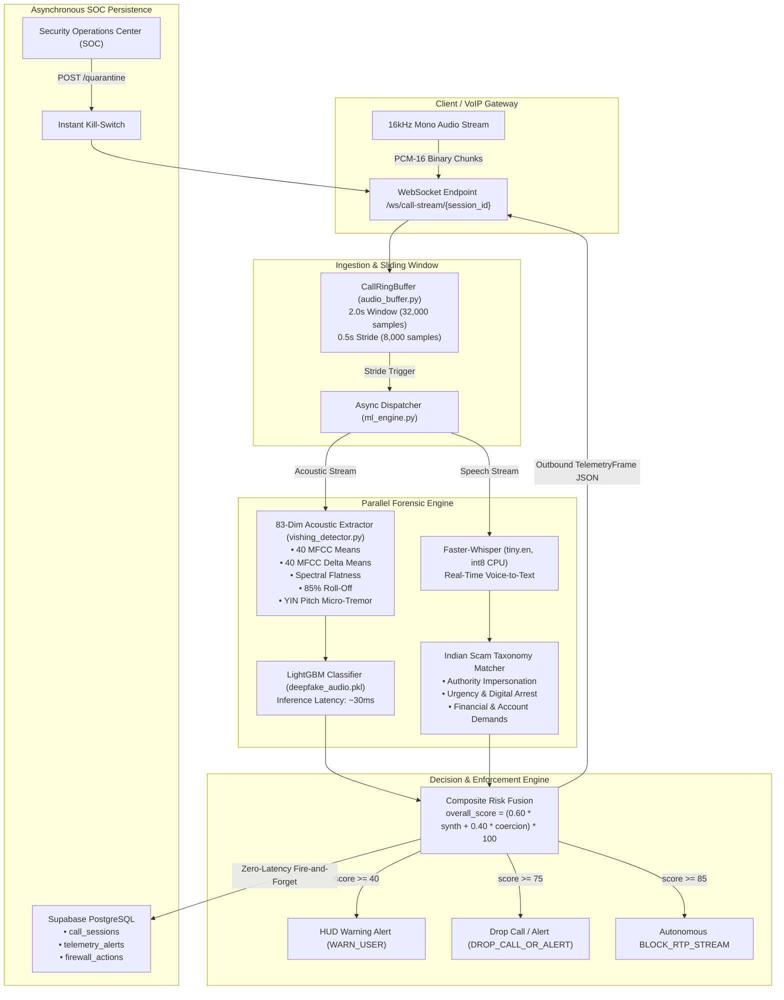

# Kavach-VoIP 🛡️
### Real-Time Deepfake Voice & Vishing Network Call Firewall
**Built for SVIT HackFest 2026 by Team Runtime Terrors**

[](https://fastapi.tiangolo.com)
[](https://python.org)
[](https://lightgbm.readthedocs.io)
[](https://github.com/SYSTRAN/faster-whisper)
[](https://librosa.org)
[](https://supabase.com)
[](https://render.com)
[](LICENSE)

---

## 🌐 Live Production Deployments

| Resource | URL |
| :--- | :--- |
| **Production Backend API** | [https://kavach-n5na.onrender.com](https://kavach-n5na.onrender.com) |
| **Interactive Swagger Docs** | [https://kavach-n5na.onrender.com/docs](https://kavach-n5na.onrender.com/docs) |
| **Live Health & ML Diagnostics** | [https://kavach-n5na.onrender.com/health](https://kavach-n5na.onrender.com/health) |
| **Real-Time WebSocket Stream** | `wss://kavach-n5na.onrender.com/ws/call-stream/{session_id}` |

---

## 🚨 Problem Statement: The "Digital Arrest" Epidemic

Across India, cybercrime syndicates are exploiting **ultra-realistic AI voice cloning** (ElevenLabs, XTTS-v2, Bark, RVC) to execute devastating **"Digital Arrest"** and emergency extortion scams:
- Fraudsters impersonate senior IPS officers, CBI inspectors, Supreme Court officials, Customs agents, or distressed family members.
- Victims are coerced into multi-hour video/audio confinement under threat of non-bailable warrants and coerced into transferring their life savings to fictitious **"RBI Safe Verification Accounts"** via RTGS/IMPS.
- **Why Traditional Call Defenses Fail**: Static spam-call apps (Truecaller, carrier blocklists) rely exclusively on phone number reputation. Sophisticated scam networks spoof legitimate PBX caller IDs or register disposable VoIP numbers every hour. Once the call connects, traditional tools have **zero acoustic or semantic visibility into the live conversation**.

**Kavach-VoIP** acts as an **in-line carrier & enterprise gateway call firewall**. It streams live bi-directional audio mid-call, performs parallel acoustic vocoder forensics and semantic coercion analysis, and autonomously terminates fraudulent calls before money moves.

---

## 🏗️ System Architecture & Real-Time Pipeline



### Core Architecture Components:

1. **Audio Capture & Ring Buffer ([audio_buffer.py](audio_buffer.py))**:
   - Ingests raw 16-bit little-endian PCM audio bytes at 16,000 Hz mono.
   - Normalizes audio to `np.float32` in `[-1.0, 1.0]`.
   - Maintains a circular bounded deque buffer with a **2.0-second window (32,000 samples)** and **0.5-second stride (8,000 samples)**, guaranteeing cadence and sliding inference.
2. **83-Dimensional Acoustic Biomarker Engine ([vishing_detector.py](vishing_detector.py))**:
   - **40 MFCCs + 40 Deltas (80 features)**: Captures spectral envelope anomalies characteristic of neural vocoder synthesis.
   - **Spectral Flatness (1 feature)**: Measures Wiener entropy; detects unnatural noise distribution in high-frequency bands.
   - **High-Frequency Roll-Off (85% energy) (1 feature)**: Synthetic speech models often display unnatural energy fall-offs above 6.5–7 kHz.
   - **Pitch Micro-Tremor / Jitter via YIN (1 feature)**: Measures F0 variance across voiced segments. Human vocal cords naturally display subtle physiological tremors that AI vocoders over-smooth.
   - **Trained LightGBM Classifier ([deepfake_audio.pkl](deepfake_audio.pkl))**: Evaluates features in ~30ms after Numba JIT pre-compilation.
3. **Semantic Coercion & Intent Engine**:
   - **Faster-Whisper (`tiny.en`, `int8` CPU quantization)**: Low-latency streaming speech-to-text.
   - **Indian Cybercrime Taxonomy Engine**: Scans text for high-risk coercion tactics:
     - `AUTHORITY_IMPERSONATION`: CBI, Cyber Crime, Mumbai Police, Supreme Court, RBI, Customs, Inspector.
     - `URGENCY_COERCION`: Digital Arrest, non-bailable warrant, immediately, do not disconnect, under surveillance, freeze.
     - `FINANCIAL_DEMAND`: Safe verification account, RTGS, UPI, OTP, penalty, bank transfer, Aadhaar contraband.
4. **Composite Risk Scoring & Autonomous Enforcement ([main.py](main.py))**:
   $$\text{overall\_score} = \left(0.60 \times \text{synthetic\_probability} + 0.40 \times \text{coercion\_score}\right) \times 100$$
   - **`< 40` (SAFE)**: Normal conversation flow.
   - **`40 - 74` (HIGH / WARN_USER)**: Emits real-time visual warning to user interface.
   - **`>= 75` (CRITICAL / DROP_CALL_OR_ALERT)**: Marks call as severe threat; notifies SOC dashboard.
   - **`>= 85` (AUTONOMOUS FIREWALL RULE)**: Emits `BLOCK_RTP_STREAM` rule and records in `firewall_actions`.
5. **Asynchronous Supabase Persistence ([database.py](database.py))**:
   - Dual-mode database layer: Supabase PostgreSQL cloud with automatic in-memory fallback.
   - Threaded fire-and-forget logging (`asyncio.to_thread`) ensures DB writes never degrade real-time audio WebSocket latency.

---

## 🔒 Frozen WebSocket Telemetry Contract

Every ~500ms, the backend emits a strictly validated Pydantic v2 JSON frame (`TelemetryFrame`) over the WebSocket connection:

```json
{
  "session_id": "call-9821-mumbai-cbi",
  "timestamp": 1729177245.82,
  "chunk_id": 4,
  "acoustic_metrics": {
    "synthetic_probability": 0.99,
    "spectral_flatness": 0.44,
    "pitch_jitter_hz": 0.85,
    "breath_detected": false,
    "vocoder_signature": "ElevenLabs-Multilingual-v2"
  },
  "semantic_metrics": {
    "transcript_delta": "This is Inspector Sharma from Mumbai Cyber Crime. You are placed under digital arrest.",
    "coercion_score": 0.88,
    "flagged_keywords": [
      "cbi",
      "cyber crime",
      "digital arrest",
      "inspector"
    ],
    "scam_category": "DIGITAL_ARREST_COERCION"
  },
  "composite_risk": {
    "overall_score": 94.6,
    "risk_level": "CRITICAL",
    "recommended_action": "DROP_CALL_OR_ALERT"
  },
  "processing_latency_ms": 34.2
}
```

---

## 📡 API Reference & Endpoints

### REST API

| Method | Endpoint | Description |
| :--- | :--- | :--- |
| `GET` | `/health` | Server uptime, Supabase mode, ML engine status, weights loaded flag, and warmup latency. |
| `GET` | `/api/sessions` | List recent call sessions, caller numbers, peak risk scores, and verdicts. |
| `GET` | `/api/sessions/{session_id}/alerts` | Complete session detail with all high-risk acoustic & semantic alerts and firewall triggers. |
| `POST` | `/api/sessions/{session_id}/quarantine` | **SOC Kill-Switch**: Terminates live call, pushes `CALL_TERMINATED` to WebSocket, and drops session. |
| `POST` | `/api/demo/trigger-scenario` | Inject demo scenarios (`REAL_WAV_CBI`, `ELEVENLABS_DIGITAL_ARREST`, `FAMILY_EMERGENCY_CLONE`, `NORMAL_CALL`). |
| `POST` | `/api/demo/seed` | Seed realistic mock historical threat sessions into Supabase for judge demonstration. |

### WebSocket Protocol

- **Endpoint**: `/ws/call-stream/{session_id}`
- **Binary Input**: Raw 16-bit little-endian mono PCM audio chunks (at 16,000 Hz).
- **Text Commands**:
  - `{"command": "PLAY_REAL_WAV"}`: Streams `audio_samples/02_cbi_digital_arrest.wav` through the live ML engine.
  - `{"command": "SCENARIO_DIGITAL_ARREST"}`: Injects multi-stage ElevenLabs CBI impersonation sequence.
  - `{"command": "SCENARIO_FAMILY_CLONE"}`: Injects simulated distressed relative voice clone requesting emergency UPI funds.
  - `{"command": "SCENARIO_NORMAL"}`: Injects normal benign bilingual conversation.

---

## 💻 Local Setup & Installation

### 1. Prerequisites
- Python 3.11.x (recommended) or Python 3.12.x
- Git & virtual environment tool

### 2. Clone & Install Dependencies
```bash
# Clone the repository
git clone https://github.com/jeevan-9797/Runtime-terrors.git
cd Runtime-terrors

# Switch to the Backend branch
git checkout Backend

# Create and activate virtual environment
python -m venv venv
# On Windows:
.\venv\Scripts\activate
# On Linux/macOS:
source venv/bin/activate

# Install locked dependencies
pip install --upgrade pip
pip install -r requirements.txt
```

### 3. Configure Environment Variables
Create a `.env` file in the project root:
```env
KAVACH_HOST=0.0.0.0
KAVACH_PORT=8000
KAVACH_DEBUG=false
KAVACH_TELEMETRY_INTERVAL_SEC=0.5

# Supabase Database (Optional - falls back to in-memory store if omitted)
SUPABASE_URL=https://your-project.supabase.co
SUPABASE_KEY=your-supabase-service-role-or-anon-key

# Cloud Container Optimizations
WHISPER_THREADS=2
```

### 4. Database Setup (Supabase SQL)
If using Supabase, copy the contents of [schema.sql](schema.sql) into the **Supabase SQL Editor** and execute it to create the indexed tables:
- `call_sessions`
- `telemetry_alerts`
- `firewall_actions`

### 5. Start the Server
```bash
python main.py
# Or with uvicorn directly:
uvicorn main:app --host 0.0.0.0 --port 8000 --reload
```

The server automatically runs `ml_engine.warmup()` on startup to pre-compile JIT routines and caches model weights in RAM.
Visit `http://localhost:8000/docs` to test all interactive endpoints.

---

## 👥 Team Runtime Terrors — SVIT HackFest 2026

| Team Member | Role & Key Contributions |
| :--- | :--- |
| **Jeevan** | **Backend Architecture & Cloud Engineering**<br/>• FastAPI asynchronous streaming architecture and WebSocket pipeline.<br/>• Real-time sliding `CallRingBuffer` with stride boundary triggering.<br/>• Supabase dual-mode persistence layer with zero-latency fire-and-forget logging.<br/>• Render cloud optimization (512MB RAM tuning, CTranslate2 thread limits, GC warmup). |
| **Jyotir** | **AI/ML & Audio Forensic Pipeline**<br/>• 83-dimensional acoustic biomarker extraction pipeline (MFCCs, spectral flatness, roll-off, YIN pitch jitter).<br/>• LightGBM deepfake voice classification model training & artifact serialization.<br/>• Faster-Whisper int8 quantization integration & Indian cybercrime semantic taxonomy. |
| **Hemachandra** | **Cyber-SOC Dashboard & Frontend UI/UX**<br/>• Cyber-SOC real-time monitoring dashboard and threat telemetry charts.<br/>• WebAudio 16kHz microphone stream capture and PCM-16 encoding.<br/>• Visual threat HUD, alert notifications, and SOC manual kill-switch interface. |

---

## 📜 License
This project is licensed under the MIT License — see the [LICENSE](LICENSE) file for details. Built with pride for SVIT HackFest 2026.